# JMeter Performance Phase Analyzer

[](https://github.com/srenevasanks/jmeter-performance-phase-analyzer/actions/workflows/build.yml)
[](LICENSE)

Understand how API performance changes during **ramp-up, steady load, ramp-down and complete execution** without changing your JMeter workload. Performance Phase Analyzer is a native Swing listener with live metrics, configurable analytical phases, one-file offline HTML reports and seven-sheet Excel workbooks.

**v1.1.2 · Java 17 · Apache JMeter 5.6.3 · Apache License 2.0**

[Published releases](https://github.com/srenevasanks/jmeter-performance-phase-analyzer/releases) · [Sample reports](examples/README.md) · [Screenshots](screenshots/README.md) · [Compatibility](docs/COMPATIBILITY.md)

## What the listener provides

- Discover actual Thread Group implementations and read supported native schedules automatically, or define manual analytical phase windows.
- Separate ramp-up, steady-load, ramp-down and complete-execution results, retaining eligible samples outside configured analytical phases.
- Track sample counts, success/failure, average, nearest-rank median/P90/P95/P99, min/max, population standard deviation, error %, throughput and received/sent KB/sec.
- Inspect configured load, observed users where available, response trends, error spikes and per-API aggregates.
- Capture Requests, Transactions or Separate populations. Filter phases and API labels without modifying collected data.
- Export HTML or Excel through Save dialogs. Buttons remain disabled without samples; automatic export is off unless explicitly enabled.
- **Stop Capture stops this listener only.** JMeter continues normally. Restarting capture creates a new independent session; JMeter's native Stop/Shutdown controls the actual test.

### Changes in v1.1.2

Thread Group identities are synchronized around native editor commits and Start/Save actions. Group changes update the analysis selection and discard stale asynchronous display results. Current throughput now uses completed one-second windows rather than an incomplete timeline bucket. The approved Swing layout, HTML/Excel designs and exported metric calculation engine are preserved.

The local patch build passed **62 automated tests**; [final CI failed a partial-snapshot assertion](https://github.com/srenevasanks/jmeter-performance-phase-analyzer/actions/runs/40536927242), so v1.1.2 remains unreleased. Targeted native runs captured **659 samples**, with **2,432 independent JTL/report checks and no calculation discrepancies**. Final interactive re-verification of the corrected Start/Save sequence remains pending; all nine implementations retain **Partial overall validation status**. See [validation scope and limits](docs/VALIDATION.md).

## Visual Walkthrough

The three native listener tabs below use existing representative captures. Select a Thread Group in the [complete validation collection](screenshots/validation/README.md) to inspect its own available views. No screenshots were recreated for this documentation update.

### 1. Dashboard

The Dashboard shows capture status, selected Thread Group, current phase, elapsed time, active users, six KPIs, phase summaries, execution progress and collapsible Test Information. Select a phase to inspect its results, then choose **Generate HTML Report** or **Export Excel**.

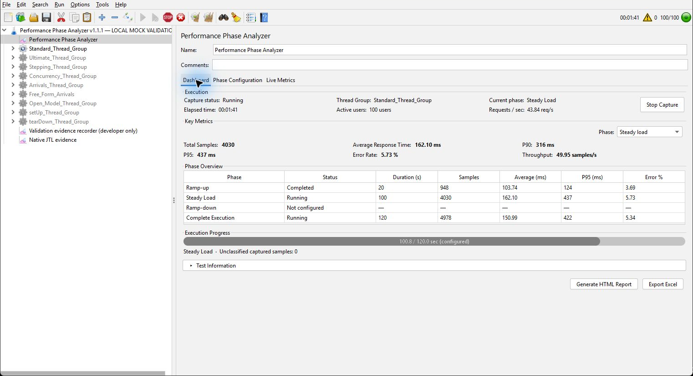

The screenshots below and throughout this repository are genuine **v1.1.1 validation captures**, reused to illustrate the preserved UI/report designs. They are not new v1.1.2 GUI verification. In particular, the older Dashboard's Requests/sec label predates the v1.1.2 Current throughput display. Screenshot title bars were cropped for path privacy; content was not redrawn. [Provenance](screenshots/README.md).

<details><summary>Ready and completed states</summary>

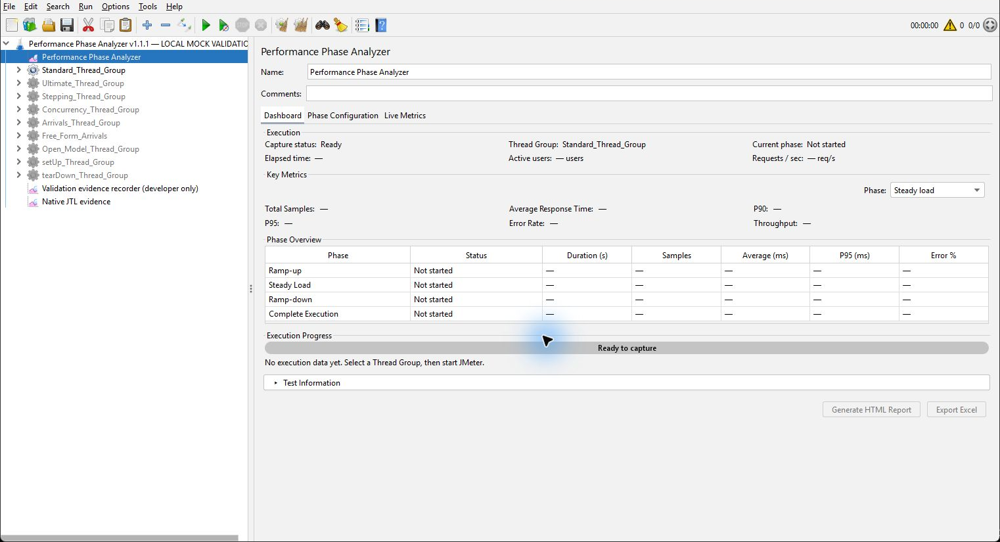
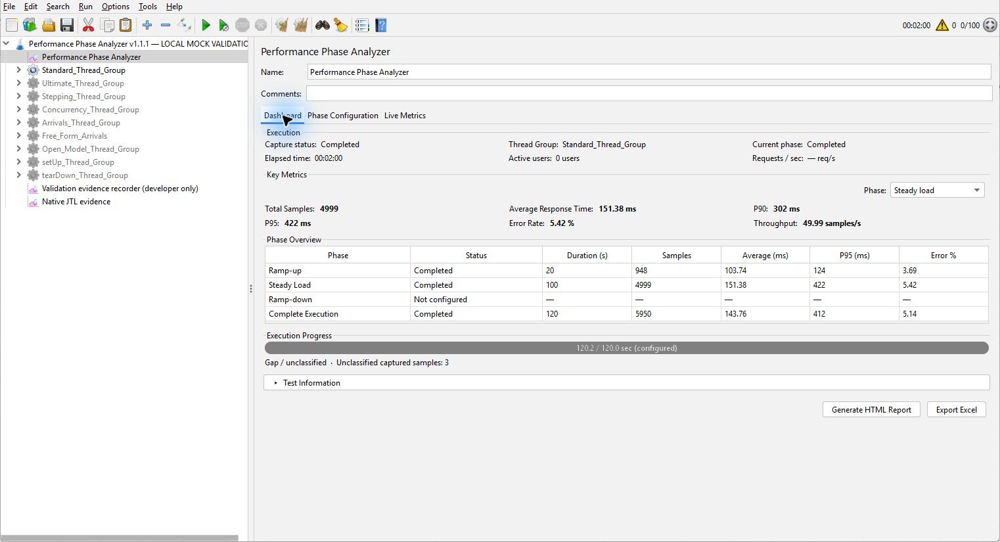

</details>

### 2. Phase Configuration

Select a Thread Group and choose **Automatic** to inspect its detected native implementation and read-only configured durations. Unsupported or ambiguous schedules are identified explicitly. The analyzer does not infer phase boundaries from response times or observed concurrency.

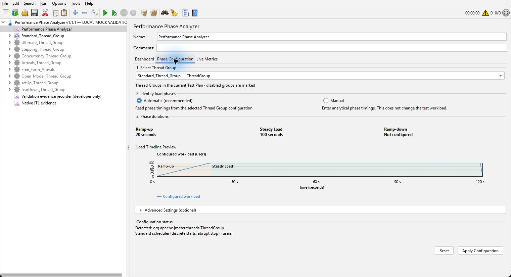

Use **Manual** for analytical durations in seconds or minutes, allowing absent phases. Manual configuration changes analysis windows, not the native workload. The duration-only preview does not invent a concurrent-user curve.

<details><summary>Manual analytical preview</summary>

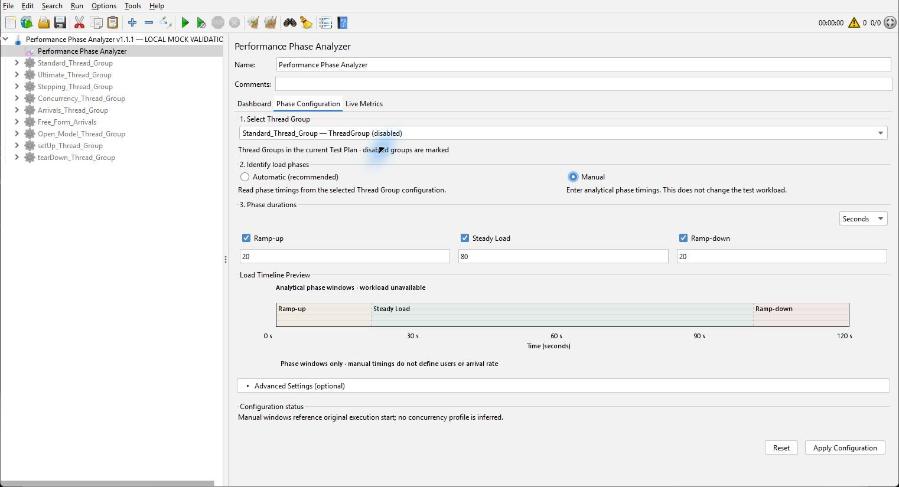

This capture is an unapplied 20/80/20-second preview. It does not establish a native ramp-down for the Standard Thread Group.

</details>

### 3. Live Metrics and Aggregate Results

Choose All Metrics, Passed Requests, Failed Requests, Throughput, Average Response Time, P95 Response Time or Error Rate. The timeline provides phase boundaries, units and a compact legend. All Metrics explicitly normalizes series; individual views use their own units. The aggregate table supports phase selection, API search and horizontal scrolling.

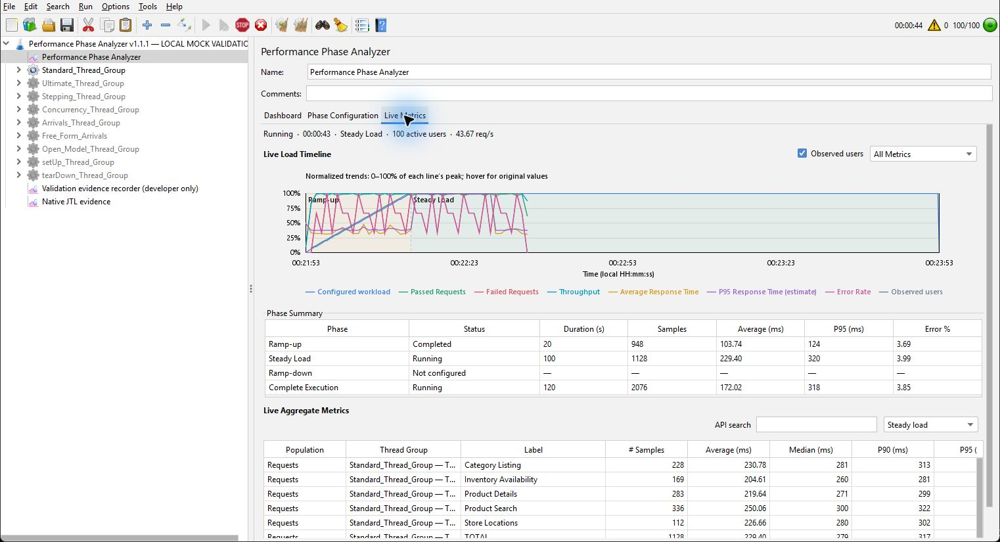

**Current throughput** counts accepted sample completions over up to five fully completed one-second intervals. The first partial capture second and current partial second are excluded. Startup shows Warming up; idle intervals count in the denominator. Failed samples count as samples. At capture end the display freezes at that cutoff. Units are **samples/sec**. Overall/phase exported throughput continues to use its documented effective-window denominator.

<details><summary>Observed error burst, recovery and aggregate view</summary>

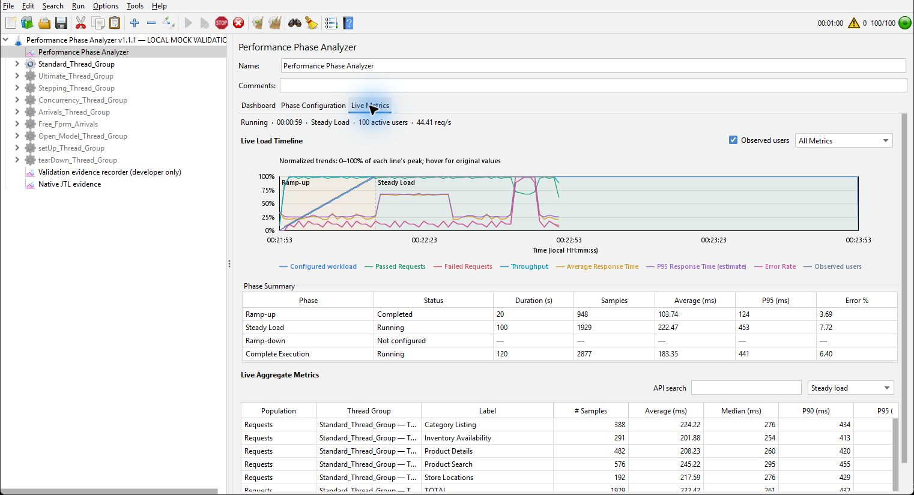
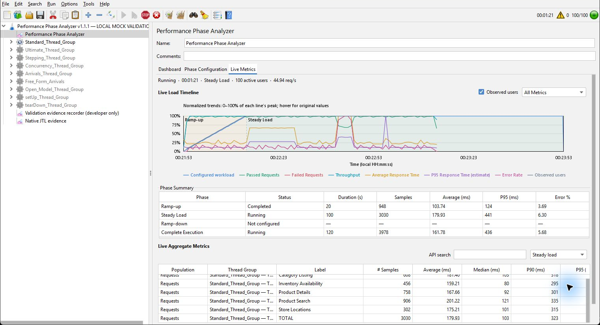

</details>

## HTML reporting

Export one self-contained HTML file that works offline, without a server or external assets. It supports light/dark switching, phase selection, API search, numeric sorting, interactive chart legends and tooltips.

| Section | Contents |
|---|---|
| 1–3 | Execution Summary, Overall Key Metrics, Phase Results Summary |
| 4–6 | Active Users Timeline, Response Time Trend, Throughput & Error Rate |
| 7–9 | Aggregate Results by API, Response Codes Summary, Execution Configuration Details |

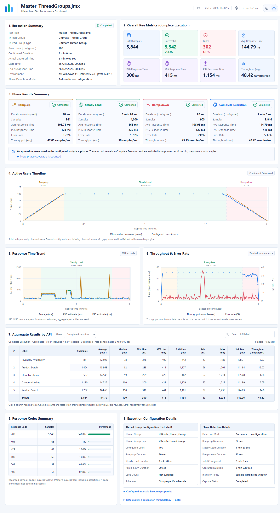

<details><summary>Dark report and individual sections</summary>

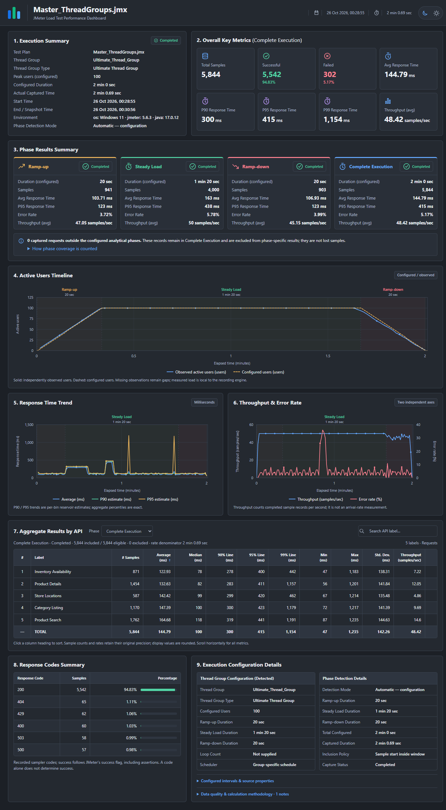

View [all nine section screenshots](screenshots/README.md) or download the [Ultimate HTML example](examples/ultimate/report.html). GitHub displays HTML source; download the file and open it locally for interaction.

</details>

## Excel reporting

Each workbook contains **Execution Summary, Ramp-up, Steady Load, Ramp-down, Complete Execution, Response Codes and Execution Configuration**. Structured summaries, readable dates/durations, formatted aggregate tables, filters and frozen identifiers preserve the same metrics used by HTML. The summary includes a native Average/P90/P95 comparison chart where data permits. Unavailable phases remain unavailable.

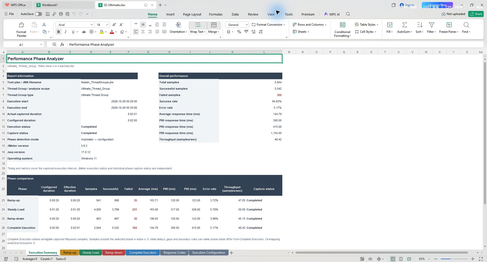

[All seven worksheets and chart screenshots](screenshots/README.md) · [Download Ultimate Excel example](examples/ultimate/report.xlsx) · [Excel calculation/format details](docs/EXCEL-REPORT.md)

Suggested report filenames are `<JMX_Name>_yyyy-MM-dd_HH-mm-ss.html` and `.xlsx`, using the same local execution-start timestamp. Names are sanitized and existing files are protected against accidental overwriting. An unresolved JMX filename is shown as unavailable. Only the selected export is created; internal capture data stays outside the report directory and ordinary JMeter JTL files are unaffected.

## Thread Group Compatibility & Screenshots

Browse **252 original screenshots** by Thread Group below. The existing 36-image curated gallery is preserved, giving **288 published screenshots**. All nine groups remain **Partial**: configuration detection and reconciled reports do not establish fully certified GUI/lifecycle compatibility.

The evidence comes from nine independent v1.1.1 local mock executions: **51,177 actual HTTP samples, 13,492 independent JTL/report checks and zero report calculation differences**. No performance tests were rerun for this update. Durations below are ramp-up / steady / ramp-down, in seconds; absent native phases were not fabricated.

| Group (original captures) | Configured load model / phases | Detection and limits | Listener | HTML screenshots | Excel screenshots | Sample reports |
|---|---|---|---|---|---|---|
| [Standard (34)](screenshots/validation/01-Standard/) | 100 concurrent users; 20/100/absent seconds | No native gradual ramp-down. | [Views](screenshots/validation/01-Standard/#listener) | [Views](screenshots/validation/01-Standard/#html-reports) | [Views](screenshots/validation/01-Standard/#excel-reports) | [HTML](examples/standard/report.html) / [Excel](examples/standard/report.xlsx) |
| [Ultimate (27)](screenshots/validation/02-Ultimate/) | 100 concurrent users; 20/80/20 seconds | Scheduled three-phase user profile; arbitrary multi-row schedules are not exhaustively certified. | [Views](screenshots/validation/02-Ultimate/#listener) | [Views](screenshots/validation/02-Ultimate/#html-reports) | [Views](screenshots/validation/02-Ultimate/#excel-reports) | [HTML](examples/ultimate/report.html) / [Excel](examples/ultimate/report.xlsx) |
| [Stepping (27)](screenshots/validation/03-Stepping/) | 100 concurrent users; 20/80/20 seconds | Native discrete user steps, not a smooth linear ramp. | [Views](screenshots/validation/03-Stepping/#listener) | [Views](screenshots/validation/03-Stepping/#html-reports) | [Views](screenshots/validation/03-Stepping/#excel-reports) | [HTML](examples/stepping/report.html) / [Excel](examples/stepping/report.xlsx) |
| [Concurrency (27)](screenshots/validation/04-Concurrency/) | 100 concurrent users; 20/100/absent seconds | No native gradual ramp-down in this plan. | [Views](screenshots/validation/04-Concurrency/#listener) | [Views](screenshots/validation/04-Concurrency/#html-reports) | [Views](screenshots/validation/04-Concurrency/#excel-reports) | [HTML](examples/concurrency/report.html) / [Excel](examples/concurrency/report.xlsx) |
| [Arrivals (26)](screenshots/validation/05-Arrivals/) | 50 arrivals/sec plateau; 20/100/absent seconds | Arrival rate is not concurrency; no native gradual ramp-down in this plan. | [Views](screenshots/validation/05-Arrivals/#listener) | [Views](screenshots/validation/05-Arrivals/#html-reports) | [Views](screenshots/validation/05-Arrivals/#excel-reports) | [HTML](examples/arrivals/report.html) / [Excel](examples/arrivals/report.xlsx) |
| [Free-Form Arrivals (27)](screenshots/validation/06-FreeFormArrivals/) | 50 arrivals/sec plateau; 20/80/20 seconds | Three-phase arrival-rate profile; arrival rate is not concurrency. | [Views](screenshots/validation/06-FreeFormArrivals/#listener) | [Views](screenshots/validation/06-FreeFormArrivals/#html-reports) | [Views](screenshots/validation/06-FreeFormArrivals/#excel-reports) | [HTML](examples/free-form-arrivals/report.html) / [Excel](examples/free-form-arrivals/report.xlsx) |
| [Open Model (26)](screenshots/validation/07-OpenModel/) | 50 arrivals/sec plateau; 20/80/20 seconds | Native random-arrival profile; stale-selection and observed-worker evidence limits remain disclosed. | [Views](screenshots/validation/07-OpenModel/#listener) | [Views](screenshots/validation/07-OpenModel/#html-reports) | [Views](screenshots/validation/07-OpenModel/#excel-reports) | [HTML](examples/open-model/report.html) / [Excel](examples/open-model/report.xlsx) |
| [setUp (27)](screenshots/validation/08-SetUp/) | 100 users; setup lifecycle; 20/100/absent seconds | Executed alone in the native setup lifecycle; no gradual ramp-down. | [Views](screenshots/validation/08-SetUp/#listener) | [Views](screenshots/validation/08-SetUp/#html-reports) | [Views](screenshots/validation/08-SetUp/#excel-reports) | [HTML](examples/setup/report.html) / [Excel](examples/setup/report.xlsx) |
| [tearDown (31)](screenshots/validation/09-TearDown/) | 100 users; teardown lifecycle; 20/100/absent seconds | Executed alone in the native teardown lifecycle; no gradual ramp-down. | [Views](screenshots/validation/09-TearDown/#listener) | [Views](screenshots/validation/09-TearDown/#html-reports) | [Views](screenshots/validation/09-TearDown/#excel-reports) | [HTML](examples/teardown/report.html) / [Excel](examples/teardown/report.xlsx) |

Ultimate, Stepping, Concurrency, Arrivals and Free-Form Arrivals use optional Custom Thread Groups 3.1.1. Standard, Open Model, setUp and tearDown are from JMeter 5.6.3. Arrival rate is never treated as concurrent users. setUp/tearDown were run separately in their native lifecycle.

Each group directory indexes its actual configuration, listener states, nine HTML sections, light/dark views, seven Excel sheets and chart. Missing captures are explicitly listed: normal-traffic Live Metrics views are absent for Arrivals/Open Model/setUp; separate completed Dashboard captures exist only for Standard/tearDown. Initial Open Model/setUp stale-selection screenshots intentionally retain the observed defect; tearDown burst evidence is completed history. Manual images are unapplied previews.

Original filenames and image bytes are preserved in the complete collection, including any historical title-bar paths. Earlier curated images may be cropped; neither collection is newly generated or substituted between groups. The screenshots illustrate the preserved v1.1.1 interface and reports, not new interactive proof of v1.1.2 fixes.

[Full collection index](screenshots/validation/README.md) · [Curated gallery and provenance](screenshots/README.md) · [Compatibility matrix](docs/COMPATIBILITY.md) · [Validation limitations](docs/VALIDATION.md) · [Sample report explanations](examples/README.md)

## Installation

| Requirement | Version / dependency policy |
|---|---|
| Java | 17 |
| Apache JMeter | Complete official 5.6.3 binary distribution |
| Jackson | Stock JMeter 5.6.3 supplies 2.16.1; do not add another copy |
| Custom Thread Groups | Optional 3.1.1, required only for Ultimate, Stepping, Concurrency, Arrivals and Free-Form Arrivals workloads; install its normal dependencies, including common library 0.7 |
| Maven | 3.9.x + JDK 17, development/build only |

1. Download the published [`jmeter-performance-phase-analyzer-1.1.1.jar`](https://github.com/srenevasanks/jmeter-performance-phase-analyzer/releases/download/v1.1.1/jmeter-performance-phase-analyzer-1.1.1.jar).
2. Close JMeter and move older versions of this analyzer outside `<JMETER_HOME>/lib/ext`.
3. Copy the JAR to `<JMETER_HOME>/lib/ext/`, keeping exactly one analyzer version.
4. Restart JMeter 5.6.3 with Java 17.
5. Add **Test Plan → Add → Listener → Performance Phase Analyzer**.

JMeter supplies the provided runtime dependencies. Do not copy Maven dependency JARs into the installation. Optional Thread Groups are installed separately; they are not bundled. No Excel/WPS installation, external server or browser-based listener UI is required. Native Swing controls follow JMeter's Look and Feel. **This plugin has not been submitted to JMeter Plugins Manager.** Historical [clean-install evidence](docs/CLEAN-INSTALL-VERIFICATION.md) is explicitly versioned; current patch evidence is in [VALIDATION.md](docs/VALIDATION.md).

## Quick start

Open [examples/local-demo.jmx](examples/local-demo.jmx). It runs two users for four seconds with a local Groovy sampler that waits 25 ms and returns a success response. It makes no network requests and needs no private service.

1. Select the listener and inspect Automatic phase configuration.
2. Execute the plan and inspect Dashboard / Live Metrics.
3. Select Generate HTML Report or Export Excel and choose a destination.
4. Use only authorized targets when replacing the local demo with HTTP requests.

For your own plan, run workload groups independently when comparing schedules. Handle setUp/tearDown according to their native lifecycle. Samples are classified by start time in `[start,end)`; strict mode additionally requires completion within the end boundary. Complete Execution retains eligible samples outside analytical phases, disclosed as unclassified. Nearest-rank percentiles and throughput denominators are described in [methodology](docs/METHODOLOGY.md).

## Build and test

```sh
git clone https://github.com/srenevasanks/jmeter-performance-phase-analyzer.git
cd jmeter-performance-phase-analyzer
mvn --batch-mode --no-transfer-progress clean verify
```

Artifact: `target/jmeter-performance-phase-analyzer-1.1.2.jar`. The complete **62-test** suite includes regression and embedded native JMeter executions without a private service. GitHub Actions runs the same Maven command on Java 17. Generated outputs, raw JTL, logs, credentials and developer-only evidence remain excluded; only the explicitly curated example HTML/XLSX files are committed.

## Known limitations

- Overall compatibility remains **Partial**; other JMeter/Java versions, platforms and arbitrary complex/dynamic schedules are not exhaustively certified.
- Final interactive v1.1.2 Start/Save switching and Dashboard/Live Metrics completion checks remain pending after computer-use activation/capture failed. Actual native editor regression tests pass; the older screenshots are not proof of a new GUI run.
- In targeted Open Model evidence, two user-count readings differed by one worker at different sampling/callback instants. Exact continuous active-worker accuracy is not proven. Earlier Arrivals evidence also had a native arrival/completion lifecycle-fact difference; statistical reports retained actual HTTP samples.
- Standard/setUp worker schedule epochs differed by 2–3 ms; analysis anchors to the first observed supported native worker clock. Missing clock evidence is disclosed instead of guessed from measured concurrency.
- No native gradual ramp-down exists for Standard, Concurrency, Arrivals, setUp or tearDown in the supplied schedules. Manual windows do not change that workload behavior.
- Force-killing the JVM can prevent finalization/cleanup. Unknown termination causes remain unknown. Distributed execution and final desktop resizing/theme behavior are not fully verified.

## Contributing and license

Report issues with sanitized plugin/JMeter/Java versions, OS, minimal JMX and expected versus actual behavior. Remove secrets and private targets before sharing evidence. Contributions should include focused tests and preserve the documented sample populations.

[Apache License 2.0](LICENSE). [NOTICE](NOTICE) attributes the Apache JMeter test fixture. This independently maintained plugin is not an official Apache Software Foundation project.
