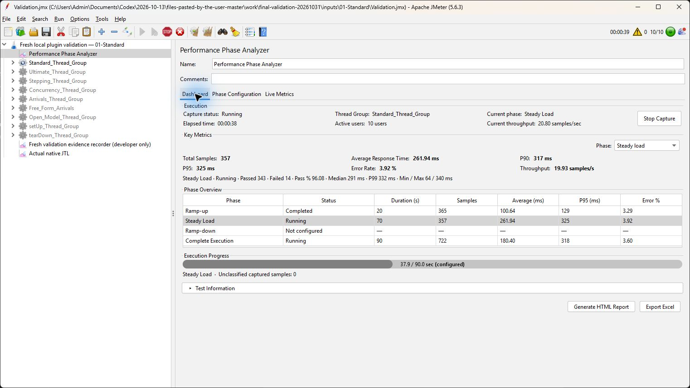
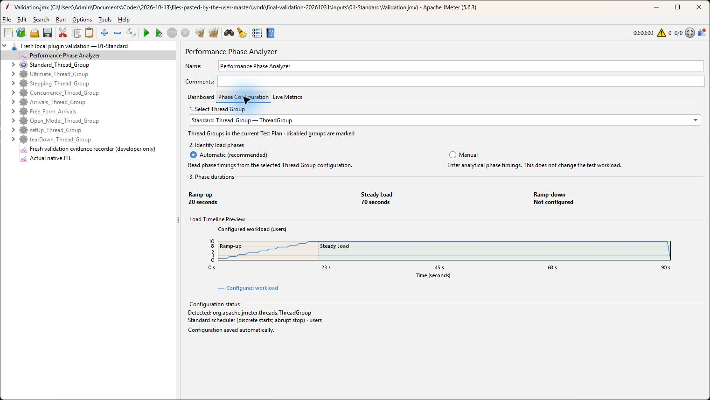
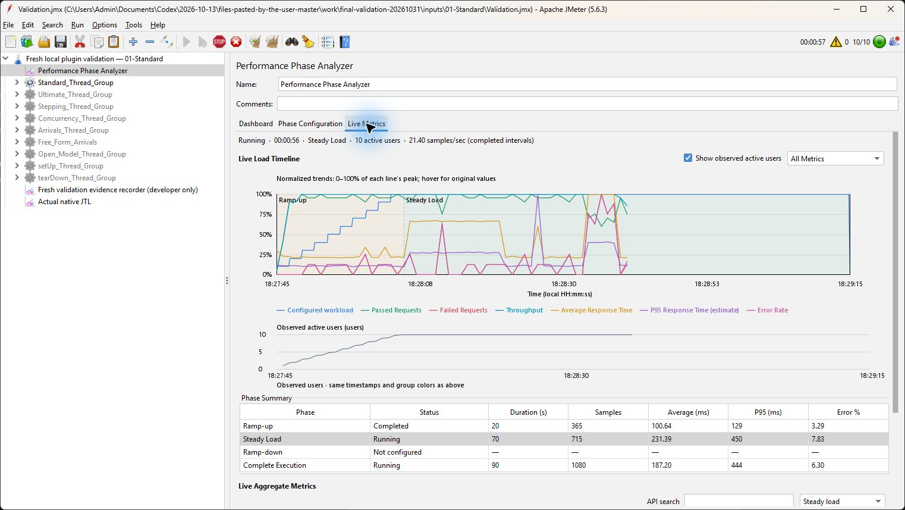
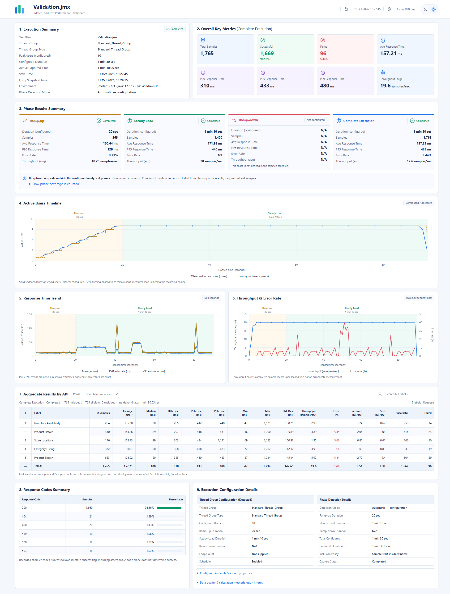
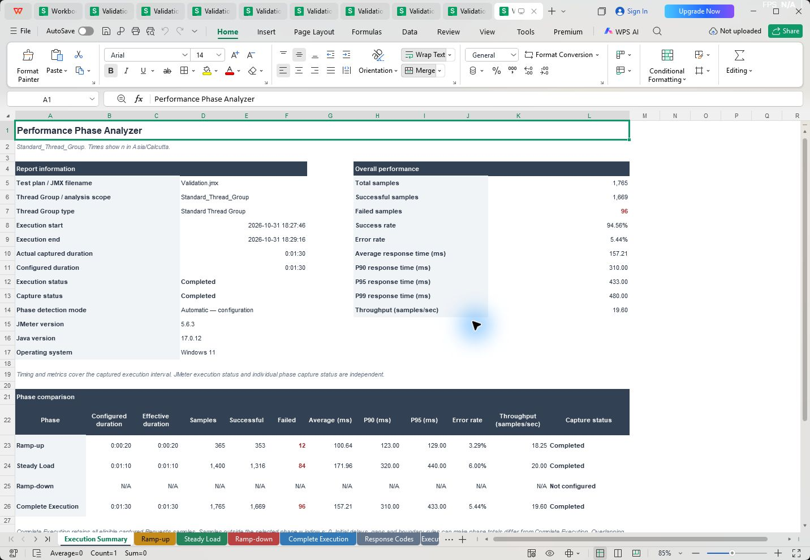

# JMeter Performance Phase Analyzer

[](https://github.com/srenevasanks/jmeter-performance-phase-analyzer/actions/workflows/build.yml)

Native Swing listener for ramp-up, steady-load, ramp-down and complete-execution API performance analysis. Java 17 · Apache JMeter 5.6.3 · Apache License 2.0. One cross-platform JAR.

**Updated source version: 1.1.2. Release publication awaits separate approval.** Final local verification: 95 automated tests and 38,308 independent comparisons, zero numerical discrepancies. Overall status remains **Partial** due to the explicit GUI/evidence limits in [current validation](docs/FINAL_VALIDATION_20261101.md). The audit itself did not publish changes.

[Current gallery](screenshots/validation/README.md) · [Actual sample reports](examples/README.md) · [Compatibility](docs/COMPATIBILITY.md)

## Features and current behavior

- Automatic is the default; valid explicitly saved per-group Manual settings restore. Schedules come from native configuration, not observed users.
- Groups follow Test Plan order and stable identities. Disabled choices stay visible but cannot be selected; first enabled group is the default, All is explicit. Selection is shared across all three tabs.
- Individual selections preserve independent sequential/parallel lifecycle, API labels and metrics, including completed and not-started groups.
- All pools participating groups, retains actual group names in API rows and distinct graph series, and computes combined percentiles from samples. Manual is disabled for All.
- Manual edits save valid settings dynamically for the next execution. No Advanced Settings, Apply or Reset controls. Active run phase boundaries remain frozen.
- Exact nearest-rank aggregate percentiles, errors, throughput, byte rates, searchable API tables, HTML and seven-sheet Excel exports.
- Generate HTML Report / Export Excel use Save dialogs and remain disabled without samples. Automatic export is off unless explicitly enabled. Stop Capture stops only this listener; JMeter continues.

## Visual Walkthrough

Current walkthrough images come from the final installed build A64E91CE2999. Older unique evidence is [historical](screenshots/historical/pre-final-20261031/README.md), not current verification.

### Dashboard

Phase-specific KPIs, selected group/lifecycle, Phase Overview, progress, Test Information, and two report actions. Explicit Steady → Complete switching is verified with actual distinct populations.



### Phase Configuration

Automatic reads native schedules. Manual saves analytical durations without changing the workload or inventing a user curve. Unsupported native phases remain unavailable.



[Current Manual next-run configuration](screenshots/listener/configuration-manual-preview.png) · [All Automatic / Manual disabled](screenshots/validation/12-All-ThreadGroups/manual-disabled-for-All-before-run.png)

### Live Metrics

Phase selection and API search scope the table. Single-group metrics use appropriate units; All Metrics separates incompatible metrics into distinct plots. All shows separate named group series and separate rows for overlapping labels.



[Running three-group series](screenshots/validation/12-All-ThreadGroups/parallel-All-running-separate-series.png) · [Combined API rows](screenshots/validation/12-All-ThreadGroups/parallel-All-running-aggregate-first-rows.png)

Current throughput uses fully completed one-second intervals; aggregate/report throughput uses documented effective phase durations. Aggregate percentiles are exact; timeline P95 estimates are labeled.

## HTML and Excel reporting

HTML remains one self-contained offline file with all nine approved sections, light/dark themes, phase selection, search, sorting, chart legends and tooltips. Excel retains the approved seven sheets, filtered/frozen aggregates and native summary chart. No report design was changed in this evidence update.





[Nine HTML sections, both themes, seven Excel sheets and charts](screenshots/validation/README.md) · [Download sample pairs](examples/README.md) · [Excel details](docs/EXCEL-REPORT.md)

## Thread Group Compatibility & Screenshots

All nine ran independently using actual local mock HTTP samples. Numerical comparisons passed; overall validation remains Partial.

| Group | Actual samples | Independent checks | Result | Evidence |
|---|---:|---:|---|---|

| 01-Standard | 1,765 | 1,207 | PASS (scoped metrics) / Partial overall | [Screenshots](screenshots/validation/01-Standard/README.md) · [HTML](examples/standard/report.html) · [Excel](examples/standard/report.xlsx) |
| 02-Ultimate | 1,688 | 1,390 | PASS (scoped metrics) / Partial overall | [Screenshots](screenshots/validation/02-Ultimate/README.md) · [HTML](examples/ultimate/report.html) · [Excel](examples/ultimate/report.xlsx) |
| 03-Stepping | 1,748 | 1,390 | PASS (scoped metrics) / Partial overall | [Screenshots](screenshots/validation/03-Stepping/README.md) · [HTML](examples/stepping/report.html) · [Excel](examples/stepping/report.xlsx) |
| 04-Concurrency | 1,767 | 1,207 | PASS (scoped metrics) / Partial overall | [Screenshots](screenshots/validation/04-Concurrency/README.md) · [HTML](examples/concurrency/report.html) · [Excel](examples/concurrency/report.xlsx) |
| 05-Arrivals | 1,620 | 1,207 | PASS (scoped metrics) / Partial overall | [Screenshots](screenshots/validation/05-Arrivals/README.md) · [HTML](examples/arrivals/report.html) · [Excel](examples/arrivals/report.xlsx) |
| 06-FreeFormArrivals | 1,389 | 1,390 | PASS (scoped metrics) / Partial overall | [Screenshots](screenshots/validation/06-FreeFormArrivals/README.md) · [HTML](examples/free-form-arrivals/report.html) · [Excel](examples/free-form-arrivals/report.xlsx) |
| 07-OpenModel | 1,400 | 1,383 | PASS (scoped metrics) / Partial overall | [Screenshots](screenshots/validation/07-OpenModel/README.md) · [HTML](examples/open-model/report.html) · [Excel](examples/open-model/report.xlsx) |
| 08-SetUp | 1,777 | 1,207 | PASS (scoped metrics) / Partial overall | [Screenshots](screenshots/validation/08-SetUp/README.md) · [HTML](examples/setup/report.html) · [Excel](examples/setup/report.xlsx) |
| 09-TearDown | 1,777 | 1,207 | PASS (scoped metrics) / Partial overall | [Screenshots](screenshots/validation/09-TearDown/README.md) · [HTML](examples/teardown/report.html) · [Excel](examples/teardown/report.xlsx) |

## Installation

| Requirement | Version / dependency policy |
|---|---|
| Java | 17 |
| Apache JMeter | Complete official 5.6.3 binary distribution |
| Jackson | Stock JMeter 5.6.3 supplies 2.16.1; do not add another copy |
| Custom Thread Groups | Optional 3.1.1, required only for Ultimate, Stepping, Concurrency, Arrivals and Free-Form Arrivals workloads; install its normal dependencies, including common library 0.7 |
| Maven | 3.9.x + JDK 17, development/build only |

1. Download the published [`jmeter-performance-phase-analyzer-1.1.1.jar`](https://github.com/srenevasanks/jmeter-performance-phase-analyzer/releases/download/v1.1.1/jmeter-performance-phase-analyzer-1.1.1.jar).
2. Close JMeter and move older versions of this analyzer outside `<JMETER_HOME>/lib/ext`.
3. Copy the JAR to `<JMETER_HOME>/lib/ext/`, keeping exactly one analyzer version.
4. Restart JMeter 5.6.3 with Java 17.
5. Add **Test Plan → Add → Listener → Performance Phase Analyzer**.

JMeter supplies the provided runtime dependencies. Do not copy Maven dependency JARs into the installation. Optional Thread Groups are installed separately; they are not bundled. No Excel/WPS installation, external server or browser-based listener UI is required. Native Swing controls follow JMeter's Look and Feel. **This plugin has not been submitted to JMeter Plugins Manager.** Historical [clean-install evidence](docs/CLEAN-INSTALL-VERIFICATION.md) is explicitly versioned; current local evidence is in [FRESH_VALIDATION_20261030.md](docs/FRESH_VALIDATION_20261030.md).

## Quick start

Open [examples/local-demo.jmx](examples/local-demo.jmx). It runs two users for four seconds with a local Groovy sampler that waits 25 ms and returns a success response. It makes no network requests and needs no private service.

1. Select the listener and inspect Automatic phase configuration.
2. Execute the plan and inspect Dashboard / Live Metrics.
3. Select Generate HTML Report or Export Excel and choose a destination.
4. Use only authorized targets when replacing the local demo with HTTP requests.

For your own plan, run workload groups independently when comparing schedules. Handle setUp/tearDown according to their native lifecycle. Samples are classified by start time in `[start,end)`; strict mode additionally requires completion within the end boundary. Complete Execution retains eligible samples outside analytical phases, disclosed as unclassified. Nearest-rank percentiles and throughput denominators are described in [methodology](docs/METHODOLOGY.md).

## Build and test

```sh
git clone https://github.com/srenevasanks/jmeter-performance-phase-analyzer.git
cd jmeter-performance-phase-analyzer
mvn --batch-mode --no-transfer-progress clean verify
```

Artifact: `target/jmeter-performance-phase-analyzer-1.1.2.jar`. The complete **76-test** suite includes regression and embedded native JMeter executions without a private service. GitHub Actions runs the same Maven command on Java 17. Generated outputs, raw JTL, logs, credentials and developer-only evidence remain excluded; only the explicitly curated example HTML/XLSX files are committed.

## Known limitations

- JMX reopen in the same GUI can leave the dropdown showing the old phase while internal scope resets to Steady. Explicitly select a phase to synchronize the controls. This remains a confirmed defect, not a validated pass.
- All Configuration can show misleading Waiting for capture text after completion, although combined Dashboard/Live data exists.
- Sequential TG2-selected Running and parallel individual-selected Running screenshots remain missing. Stale-open-popup disable and selected deletion transitions have automated coverage but were not repeated interactively.
- Windows GUI retries were performed; actual macOS GUI verification and exhaustive resize/theme permutations remain pending. One JAR and platform-independent paths are preserved.
- Complex multi-row schedules, distributed runs and exact continuous worker-count agreement are not exhaustively certified. Native absent phases are not fabricated.

[Complete current findings and exact coverage](docs/FRESH_VALIDATION_20261030.md) · [Methodology](docs/METHODOLOGY.md) · [Historical validation](docs/VALIDATION.md)

## Contributing and license

Provide sanitized versions, OS, minimal JMX and expected/actual behavior when reporting issues. Remove secrets/private targets from shared evidence. Licensed under [Apache License 2.0](LICENSE).

Latest screenshot audit: [390 original images plus one targeted recapture; defects and evidence limits](docs/SCREENSHOT_AUDIT_20261101.md). Overall remains **Partial**; cached popup labels, completed preview/caption and combined HTML load wording are not clean passes.
