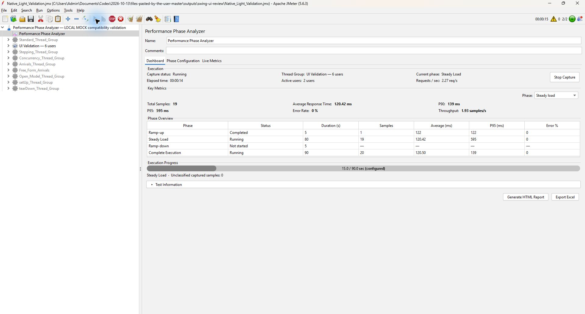
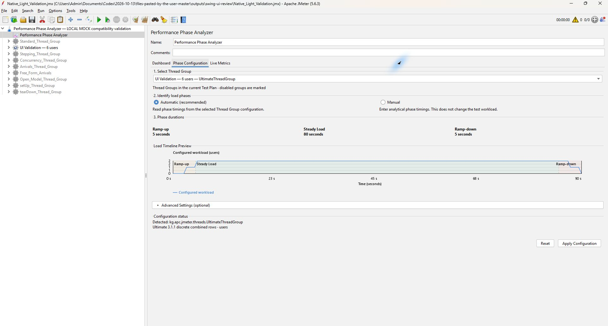
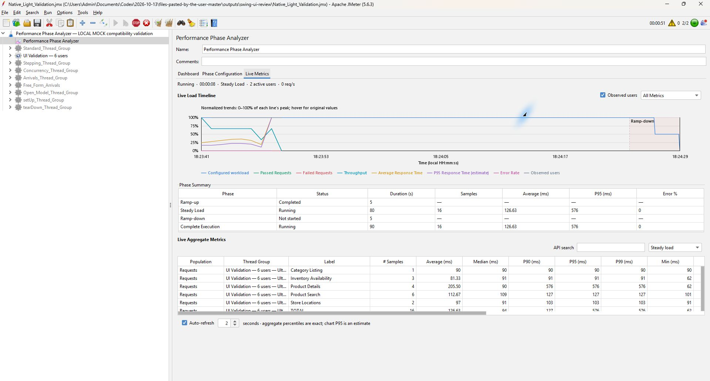
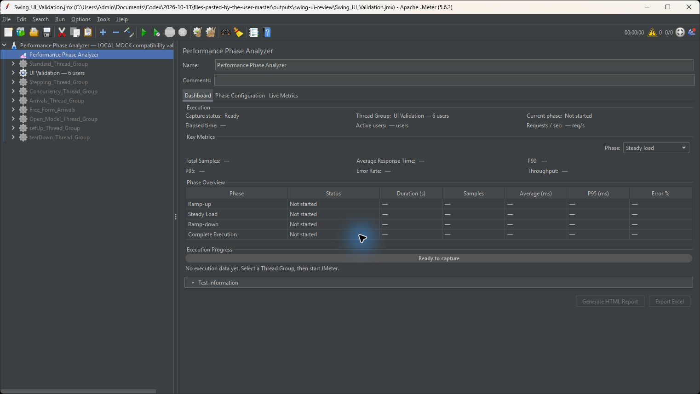

# JMeter Performance Phase Analyzer

[](https://github.com/srenevasanks/jmeter-performance-phase-analyzer/actions/workflows/build.yml)
[](LICENSE)

Analyze ramp-up, steady load, ramp-down and complete execution directly in Apache JMeter. The listener separates phase metrics, shows captured results live and produces a single offline HTML report or Excel workbook when requested.

**Version 1.1.0 · Java 17 · Apache JMeter 5.6.3**

## Why this exists

A complete-run average can hide the difference between startup, stable load and shutdown. Phase Analyzer retains the configured analytical windows and reports their actual captured samples separately, without changing your workload.

## Features

- Automatic discovery of Thread Groups in the loaded plan and schedule-aware phase detection.
- Manual optional phase durations in seconds or minutes; missing phases remain explicitly unavailable.
- Requests and transaction populations, phase selection and API-label search.
- Counts, average, nearest-rank median/P90/P95/P99, min/max, population standard deviation, throughput, error percentage and received/sent KB/sec.
- Configured and observed load timelines where supported, response-time trends and response-code counts.
- Native Swing controls that follow JMeter's active Look and Feel; no separate plugin theme.
- Stop Capture stops only this listener's collection. JMeter continues; restarting capture creates a separate session.
- HTML and Excel Save dialogs, execution-start-based names and overwrite protection. Automatic export is off unless explicitly enabled.

## Three native tabs

### Dashboard

Compact execution state, selected group, current phase, elapsed time, active users, six key metrics, phase overview, progress and collapsible test information. Generate HTML Report and Export Excel are disabled until samples exist.



### Phase Configuration

Select a discovered Thread Group, choose Automatic or Manual and inspect the native schedule or enter analytical phase durations. The preview does not invent a user curve when only manual durations are available.



### Live Metrics

Choose All Metrics, Passed Requests, Failed Requests, Throughput, Average Response Time, P95 Response Time or Error Rate. Inspect phase summaries and the searchable, horizontally scrolling aggregate table. All Metrics explicitly normalizes series; individual selections use their own units.



<details><summary>Native dark Look and Feel — actual ready state</summary>



</details>

Screenshots are actual JMeter captures. The dark image precedes final minor fixes; see [validation provenance and remaining checks](docs/VALIDATION.md).

## Compatibility

Actual independent local-mock executions covered all nine groups below. Statistical phase/aggregate metrics matched independent JTL calculations across 256,643 HTTP samples. This validates the tested plugin scenarios, not a real application's performance.

| Thread Group | Verified result |
|---|---|
| Ultimate, Stepping, Free-Form Arrivals | Passed |
| Standard, Concurrency, Arrivals, Open Model, setUp, tearDown | Partial |

Partial includes unavailable native ramp-down phases and unresolved Arrivals/Open Model lifecycle observations. It does not mean those phases were fabricated. See the [full compatibility matrix](docs/COMPATIBILITY.md). Third-party groups require **Custom Thread Groups 3.1.1** installed separately. Other JMeter/Java versions and non-Windows desktop behavior are not verified.

## Installation

1. Download `jmeter-performance-phase-analyzer-1.1.0.jar` from [Releases](https://github.com/srenevasanks/jmeter-performance-phase-analyzer/releases).
2. Close JMeter. Move any older version of this plugin outside `<JMETER_HOME>/lib/ext`.
3. Copy the downloaded JAR into `<JMETER_HOME>/lib/ext/`. Keep exactly one version.
4. Restart Apache JMeter 5.6.3 using Java 17.
5. Add **Test Plan → Add → Listener → Performance Phase Analyzer**.

JMeter supplies the provided JMeter/Jackson dependencies. Do not copy Maven dependency JARs into JMeter. Custom Thread Groups is optional and required only for its own workloads. No web server, browser UI or Excel installation is required by the listener. This plugin is **not yet submitted to JMeter Plugins Manager**.

## Quick start — no private service needed

Open [examples/local-demo.jmx](examples/local-demo.jmx). It runs two users for four seconds with a Groovy sampler that waits 25 ms and returns a local success result. It makes no network requests and is demonstration data, not application performance.

1. Select the listener and inspect Automatic configuration.
2. Run the plan and view Dashboard / Live Metrics.
3. Click Generate HTML Report or Export Excel and select a destination.

The Standard group's native schedule has ramp-up and remaining duration, without a gradual ramp-down. The plugin preserves this distinction. Save/reopen retains valid manual settings. For your own workloads, enable and test only an authorized target.

## Phase detection and calculations

Automatic uses actual configured schedules, not guessed response-time patterns. Unsupported/ambiguous schedules are identified explicitly. Manual mode defines analytical windows without changing Thread Group execution.

Default phase classification uses sample start within `[start,end)`; strict mode additionally requires completion within the end boundary. Complete Execution includes all eligible captured samples, including initial delays and gaps outside configured phases. Such samples are disclosed as unclassified rather than dropped. Throughput uses effective window duration, including idle intervals, and may differ from JMeter Aggregate Report's denominator. See [methodology](docs/METHODOLOGY.md) for exact population, percentile and missing-data rules.

## HTML and Excel reporting

HTML is one self-contained offline file with nine sections: Execution Summary, Overall Key Metrics, Phase Results Summary, Active Users Timeline, Response Time Trend, Throughput & Error Rate, Aggregate Results by API, Response Codes Summary and Execution Configuration Details. It supports phase selection, API search, sorting and light/dark switching.

Excel contains seven worksheets: Execution Summary, Ramp-up, Steady Load, Ramp-down, Complete Execution, Response Codes and Execution Configuration. HTML/Excel use the same snapshot calculations. Export the same capture cutoff when comparing populations.

Suggested filenames use `<JMX_Name>_yyyy-MM-dd_HH-mm-ss.html` or `.xlsx`, based on the execution start in local time. Invalid filename characters are sanitized. Export avoids overwriting existing files. An unresolved JMX filename is shown as unavailable rather than invented. Only the selected export is written; internal capture data stays outside the report directory. Ordinary JMeter JTL files are unaffected.

## Build and test

Requirements: JDK 17 and Maven 3.9.x; initial dependency resolution requires Maven Central access.

```sh
git clone https://github.com/srenevasanks/jmeter-performance-phase-analyzer.git
cd jmeter-performance-phase-analyzer
mvn --batch-mode --no-transfer-progress clean verify
```

Artifact: `target/jmeter-performance-phase-analyzer-1.1.0.jar`. Tests use local samplers/embedded JMeter and do not require a separately installed JMeter or private mock service. GitHub Actions runs Java 17 with the same command. The repository excludes generated reports, raw JTL, binaries, local logs and development-only tooling.

## Known limitations

- Native scheduling capability differs by group; arrival rates are not concurrent-user counts.
- Arrivals has an unresolved two-event native completion-fact difference; Open Model has unresolved active-worker observations. Statistical calculations matched JTL in both runs.
- Force-killing a JVM cannot guarantee capture finalization or temporary-file cleanup. Unknown termination causes remain unknown.
- Exact 1920×1080 desktop and final-build dark desktop rechecks remain pending; 1366×768 actual desktop and 1920×1080 component rendering were tested.
- Distributed/remote desktop workflows and other JMeter versions are not claimed as verified.

See [compatibility](docs/COMPATIBILITY.md), [validation](docs/VALIDATION.md) and [methodology](docs/METHODOLOGY.md).

## Contributing and support

Open an issue with plugin/JMeter/Java versions, OS, a sanitized minimal JMX and expected versus actual behavior. Remove credentials, personal data and private target URLs before sharing evidence. Contributions should include focused tests and preserve the documented sample populations.

## License

[Apache License 2.0](LICENSE). See [NOTICE](NOTICE) for the attributed Apache JMeter test fixture. This independently maintained plugin is not an official Apache Software Foundation project.
